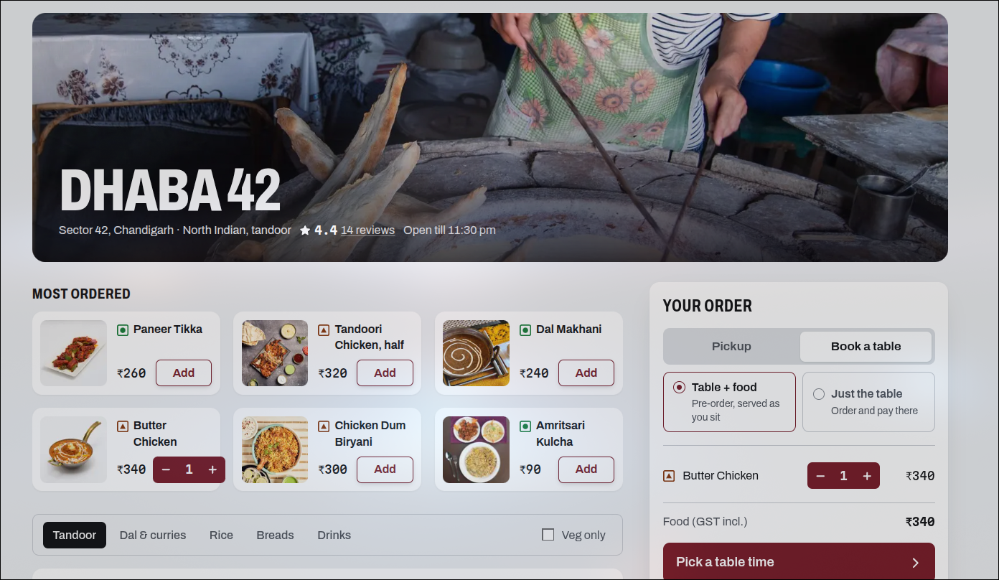
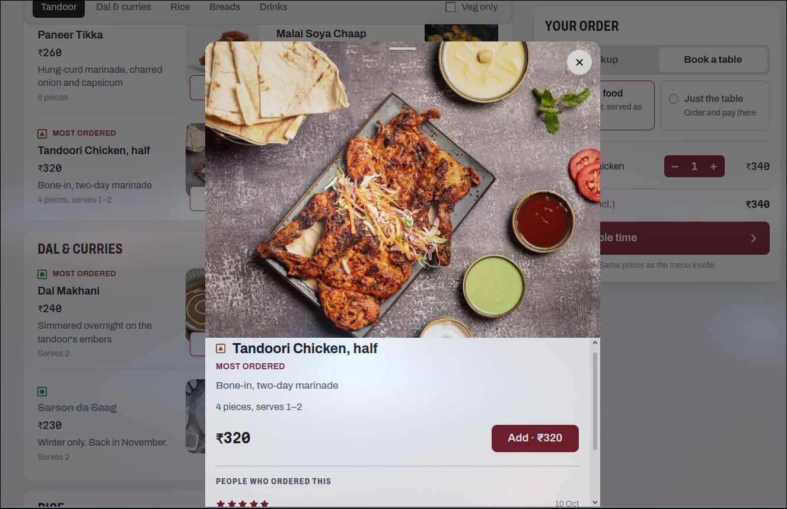
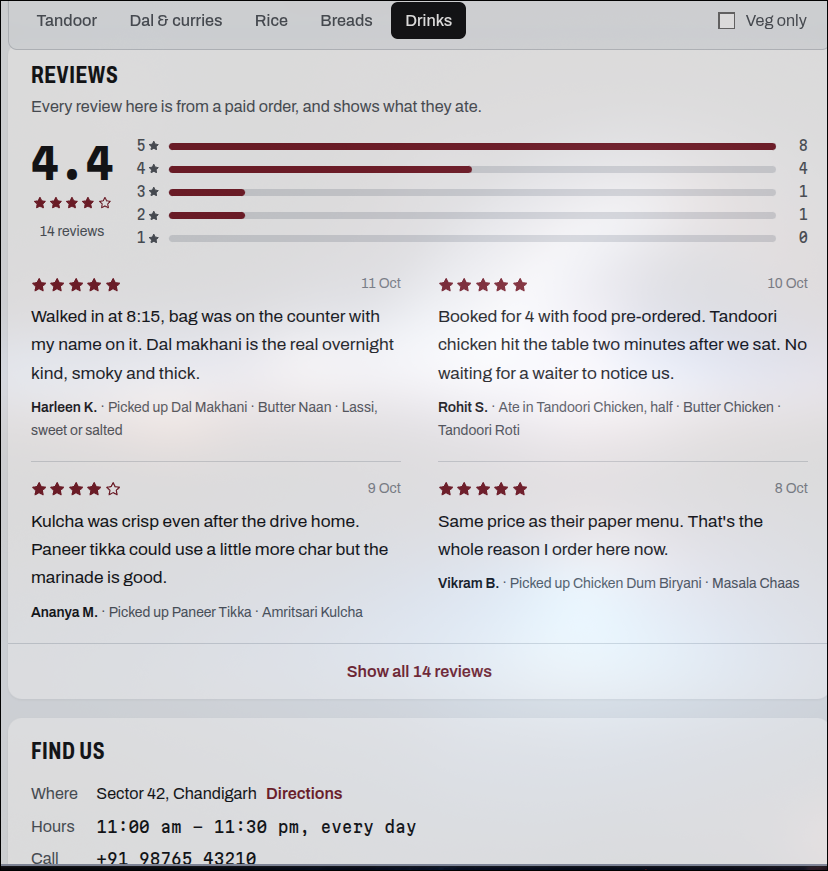
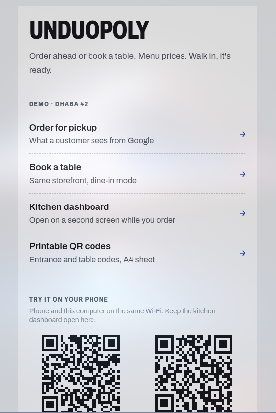

# Unduopoly

Order-ahead pickup and table booking for independent restaurants, at a flat fee per order instead of a commission.

## The idea

Food ordering in India runs through two apps, and restaurants pay them a commission on every order. Reported rates start at around 16%. Restaurants often make that back by charging more on the app than on their own paper menu.

Plenty of those orders come from people who live ten minutes away and don't need a delivery rider, but the commission is priced around delivery. The alternative isn't much better: walk in, queue at the counter, order, then wait while it's cooked.

Unduopoly leaves delivery out entirely:

- Every restaurant gets its own page, linked from the "Order" and "Reserve" buttons on its Google Maps listing.
- The customer picks pickup or a table, chooses a time, and pays.
- The food is ready when they walk in. They scan a QR code at the door and someone brings it out.
- The restaurant pays a flat ₹10–20 per order plus a one-time setup fee. Menu prices match the paper menu. The only extra on the customer's bill is the payment gateway's ~2%, shown as its own line.

The name is a jab at the duopoly.

## What was built

A working demo of the whole loop, from the customer's phone to the kitchen, around a sample restaurant called Dhaba 42.

**Restaurant storefronts.** Each restaurant gets its own subdomain (`dhaba42.unduopoly.com`) and its own brand colour and photos, with a small "Ordering by Unduopoly" in the footer. The menu has dish photos, a most-ordered row, veg/non-veg marks and portion sizes ("Serves 2", "4 skewers"). Tapping a dish opens a sheet with a larger photo and reviews from people who ordered it.

**Three ways to order:**

- **Pickup.** Pick a ready-by time. Each restaurant caps how many orders fit in a 15-minute slot, so full slots close.
- **Table + food.** Book a table and pre-order, and the food lands as you sit down. Tables are assigned by party size and kept free for the length of the meal.
- **Just the table.** Book only and order at the restaurant. Nothing to pay online. Add a dish and it switches to a pre-order on its own.

**A transparent bill.** Food (GST included), then the payment gateway charge, then the total. No packing or platform fees. Each restaurant sets its own free-cancellation cutoff, shown before payment.

**Live order status.** After paying, the customer's page follows the order through accepted, cooking, ready and collected.

**QR check-in.** A printable A4 sheet holds one entrance code plus one per table. The phone that placed the order remembers it, so scanning checks the customer in straight away. Anyone else can check in with the order code and the last four digits of the phone number.

**Kitchen dashboard.** Built for a tablet at the pass. Orders sit as tickets in New, Cooking and Ready columns. A "Here now" strip shows who has arrived and at which table, and table-only bookings get their own strip. New orders ring a bell, arrivals play a different tone, and the screen stays awake for the whole shift. If someone sits at a different table from the one they booked, the board flags it.

**Reviews tied to real orders.** Only a collected or served order can be reviewed. Each review shows the reviewer's first name and initial, plus what they actually ate.

**A demo home page** links to every screen, with QR codes for running the flow on a phone against a laptop running the kitchen.

## Under the hood

- Next.js 16 (App Router, Cache Components), React 19, TypeScript, Tailwind CSS v4
- Subdomain-per-restaurant routing in the proxy layer, with a path-based fallback
- Server actions for every mutation. Prices are always recomputed on the server from the menu, never taken from the cart.
- Money stored as integer paise. Slot and capacity maths done in IST.
- Server-rendered SVG QR codes, generated tones (Web Audio) for the kitchen bell, and the Screen Wake Lock API for the tablet
- Data sits behind a single module (in memory for the demo) so a real database can replace it. Payments are simulated; the plan was split payments, so money goes straight to the restaurant.
- The visual language comes from kitchen order tickets: torn paper edges, monospaced prices, condensed headers (Archivo and Martian Mono). Each storefront swaps in its restaurant's colour.

## Where it landed

The product side came together. The business model didn't hold up: feedback on it made clear that a flat per-order fee is very hard to sustain. Revenue doesn't grow with order size, and Google Maps alone may not bring enough discovery. So Unduopoly stays a working demo.
